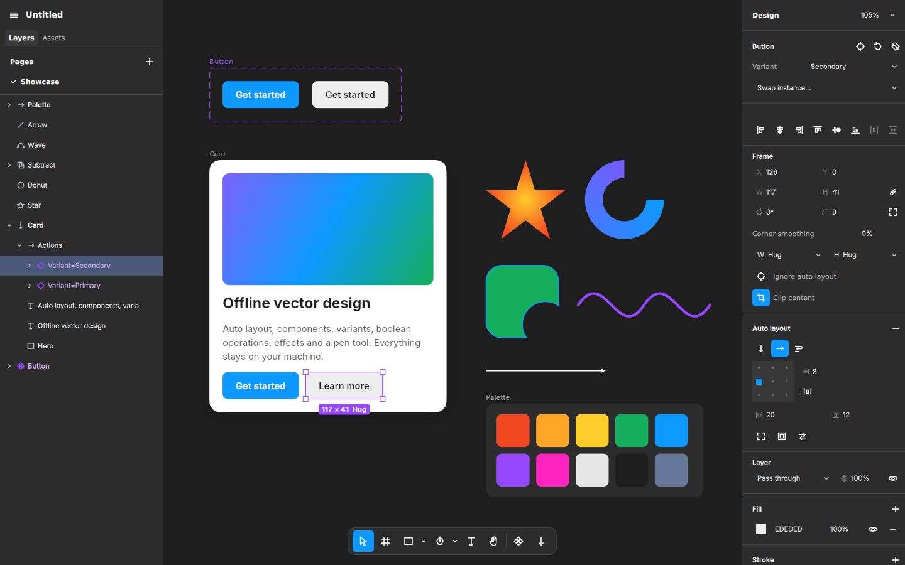

# drav

Offline vector design tool. Desktop app, Qt 6.8 / QML UI, Skia GPU canvas. No network, no telemetry, no accounts.



## Status

Milestone 1 (core editor + auto layout + components) is in place. Linux is the supported target.

| Area | What works |
| --- | --- |
| Canvas | Infinite canvas, pan (Space/middle drag/scroll), zoom (Ctrl+scroll, pinch, Shift+0/1/2), pages, outline mode, layout grids, pixel snapping |
| Layers | Frames, groups, rectangles, ellipses (arcs/donuts), polygons, stars, lines/arrows, vectors, text, boolean groups, masks |
| Tools | Move/resize/rotate (Shift/Alt modifiers, flip by dragging past), marquee, drill-in selection, drag into/out of frames, smart snapping guides, frame, shapes, pen, pencil, text, hand, vector point editing |
| Auto layout | Horizontal/vertical/wrap, gap, space-between, padding, 3×3 alignment, hug/fill/fixed sizing, min/max, absolute children, baseline, stroke inclusion, reverse z-order, drag-reorder inside layouts |
| Constraints | Left/right/left-right/center/scale (and vertical equivalents) on frame resize |
| Components | Create, instances, per-property overrides, nested instances, reset overrides, detach, go to main, swap instance, variants (combine as variants, variant switcher) |
| Paint | Solid, linear/radial/angular/diamond gradients, images (fill/fit/crop/tile), blend modes, multiple fills and strokes |
| Strokes | Inside/center/outside, weight, joins, dashes, caps and arrowheads |
| Effects | Drop shadow (with spread), inner shadow, layer blur, background blur |
| Text | Font family (bundled Inter + system fonts), weight, italic, size, line height, letter/paragraph spacing, alignment, auto width/height/fixed/truncate, case, decoration; on-canvas editing |
| Vector ops | Union/subtract/intersect/exclude, flatten, outline stroke, corner radius, Figma-style corner smoothing |
| Files | Native `.drav` (CBOR), SVG import, image import/paste/drag-drop, export PNG/JPG/WEBP/SVG/PDF at any scale, export presets per layer |
| Editing | Undo/redo for everything (typing, nudges, slider drags fold into one step), copy/paste (in place), duplicate, alt-drag copy, align/distribute, z-order, lock/hide, rename |

Not done yet (next milestones): `.fig` import, component properties (boolean/text/instance-swap), styles/variables, prototyping, vector networks (branching paths), mixed text styles in one layer, rulers/guides, comments, plugins, Windows/macOS packaging.

## Performance

The canvas is designed to stay at display refresh rate (120 Hz on a 120 Hz panel):

- Rendering runs on Qt Quick's render thread with Skia's Ganesh GL backend. Skia uses its own GL context that shares textures with Qt's, so the two never fight over GL state.
- The document is recorded into `SkPicture`s per container subtree, keyed by a per-node version counter. Panning/zooming replays cached pictures; an edit re-records only the changed subtree.
- Paragraph layout is cached per text node; decoded images are cached and shared across threads.
- The GUI thread only builds a frame snapshot (cached content picture + a small overlay picture). On the showcase file its per-frame cost rounds to 0 ms in Qt's scene graph timing (`QSG_RENDER_TIMING=1`).

`drav --bench 5` pans/zooms the showcase file and prints the frame rate.

## Build (Linux)

Requirements: Qt 6.8, CMake ≥ 3.24, Ninja, a C++20 compiler, and a static Skia build.

```bash
micromamba create -f environment.yml
```

```bash
micromamba activate drav
```

```bash
scripts/build-skia.sh third_party/skia
```

```bash
cmake -S . -B build -G Ninja -DSKIA_DIR=third_party/skia -DCMAKE_PREFIX_PATH="$CONDA_PREFIX"
```

```bash
cmake --build build && ctest --test-dir build
```

```bash
./build/src/app/drav --demo
```

Command-line options: `drav [file]`, `--demo`, `--select <layer name>`, `--screenshot <png>`, `--bench <seconds>`.

## Packages

CI (`.github/workflows/package.yml`) builds `drav_<version>_amd64.deb` for Ubuntu 24.04 on pushes to `main`, `v*` tags and PRs, then installs it on a clean `ubuntu:24.04` container and launches it. Download it from the run's artifacts, then:

```bash
sudo apt install ./drav_*_amd64.deb
```

The package bundles Qt 6.8 under `/opt/drav` (Ubuntu 24.04 ships Qt 6.4) and links `/usr/bin/drav`. Other libraries come from Ubuntu. To build it locally on Ubuntu 24.04, use the apt packages and Qt install from the workflow, then configure with `-DDRAV_PACKAGE=ON -DCMAKE_INSTALL_PREFIX=/opt/drav`, build, and run `cpack --config build/CPackConfig.cmake -B build/package`.

## Layout

```
src/core     document model, undo, auto layout, components, geometry, text, file format (no GUI)
src/render   Skia renderer with picture caching, exporters
src/app      editor state, tools, layer model, SVG import, GPU canvas item, main
qml          UI: layers/pages/assets, design inspector, toolbar, menus
tests        core, render and editor (tool-driven) tests
```

### Core ideas

- **Document** owns all nodes. Every change runs inside a transaction: `edit(id)` snapshots a node's properties on first touch, structural moves are logged, and `commit()` produces one undo step. Derived state (auto layout, instance sync, group bounds, text auto-size) is recomputed inside the same transaction so undo restores it exactly.
- **Instances** are real node trees. Each instance node keeps a `sourceId` to its counterpart in the main component and a bitmask of overridden property groups. Syncing copies only non-overridden groups, so main edits propagate while overrides stick.
- **Auto layout** runs bottom-up over changed subtrees (hug sizes) and top-down for fill children.

## Offline guarantee

The app never opens network connections. QML URL loading is restricted to bundled (`qrc:`) and local files; anything else is refused. There is no update check, crash reporter, analytics or font download — the Inter font ships in the binary.

## Shortcuts

| | |
| --- | --- |
| V / F / R / O / L / Shift+L / P / Shift+P / T / H | Move, frame, rectangle, ellipse, line, arrow, pen, pencil, text, hand |
| Ctrl+G / Ctrl+Shift+G / Ctrl+Alt+G | Group, ungroup, frame selection |
| Shift+A | Add auto layout |
| Ctrl+Alt+K / Ctrl+Alt+B | Create component, detach instance |
| Ctrl+E / Ctrl+Shift+O / Ctrl+Alt+M | Flatten, outline stroke, use as mask |
| Ctrl+D, Ctrl+C/X/V, Ctrl+Shift+V | Duplicate, clipboard, paste in place |
| Alt+A/D/W/S/H/V, Alt+Shift+H/V | Align, distribute |
| Ctrl+[ / ] (with Shift: to back/front) | Reorder |
| Shift+H / Shift+V | Flip |
| Enter / Shift+Enter / Tab | Select children / parent / next sibling; edit text or vector |
| 1–0 | Opacity 10–100% |
| Shift+0 / 1 / 2, Ctrl+Y | Zoom 100% / fit / selection, outlines |

## License

Code: to be decided by the repository owner. Bundled font: Inter, SIL Open Font License 1.1 (`resources/fonts/Inter-LICENSE.txt`).
